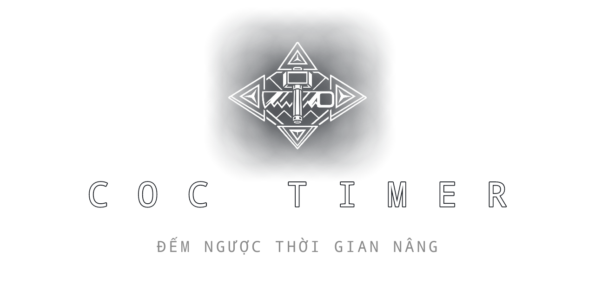
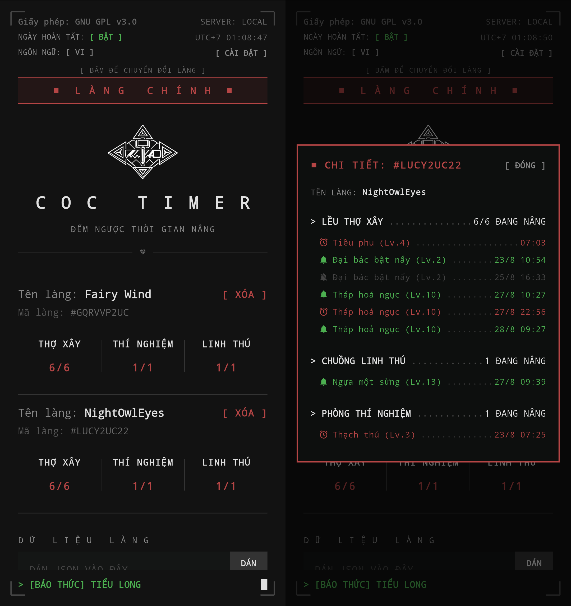
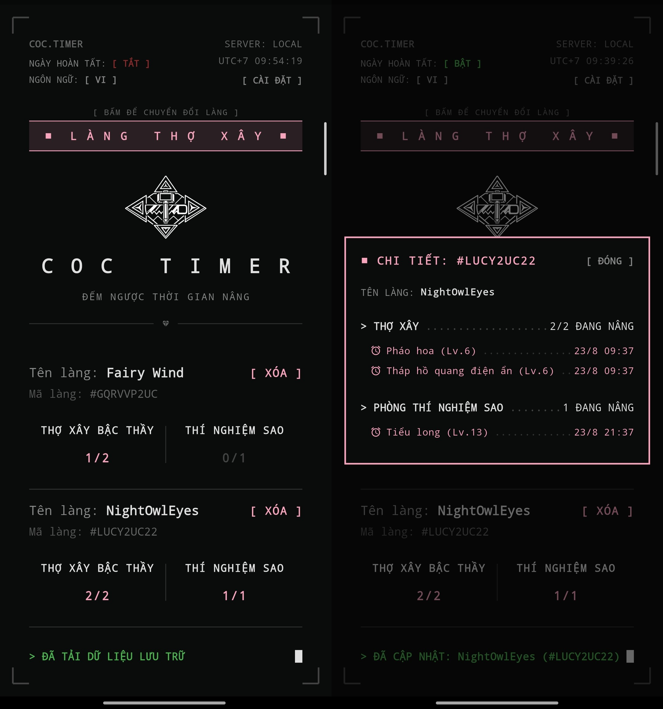
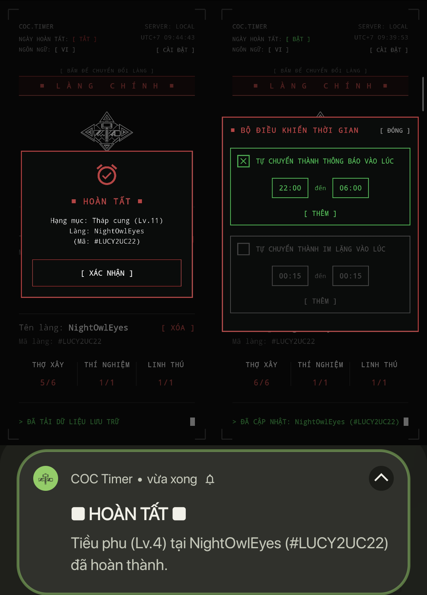

  <a href="README.md">English</a> | <a href="README-vi.md">Tiếng Việt</a>

  

## 📥 Tải xuống

| ABI | Phù hợp với | Tải xuống |
|------|-------------|-----------|
| **arm64-v8a** | ⭐ Đề xuất (phù hợp với hầu hết thiết bị Android từ khoảng 2018 đến nay). |  |
| **armeabi-v7a** | Thiết bị Android 32-bit dùng CPU ARM (khoảng trước 2017–2018). |  |
| **x86_64** | Thiết bị, giả lập Android 64-bit dùng CPU Intel/AMD x86 |  |

# COC Timer

Ứng dụng theo dõi thời gian nâng cấp công trình, thần chú, lính, linh thú... trong Clash of Clans, đồng thời tích hợp hệ thống kết nối API để theo dõi Clan War & CWL trực tuyến, kèm hệ thống nhắc nhở/báo thức thông minh.

## Tính năng

### 1. Theo dõi tiến độ Làng (Offline)
Ứng dụng hỗ trợ **3 chế độ nhắc nhở** cho từng hạng mục nâng cấp:

| Chế độ | Mô tả |
|---|---|
| 🔕 Không thông báo | Không nhắc gì khi hoàn thành |
| 🔔 Nhắc nhở bằng thông báo | Gửi thông báo khi hoàn thành |
| ⏰ Báo thức | Phát chuông báo khi hoàn thành |

### 2. Theo dõi Clan War Trực Tuyến
- **Cổng kết nối API Live:** Quét dữ liệu War thường và Clan War League (CWL) trực tiếp từ máy chủ thông qua mã Clan (Tag).
- **Đồng bộ Ngầm:** Tự động làm mới dữ liệu War chạy ngầm định kỳ.
- **Truy xuất Chưa Tấn Công:** Nhanh chóng lọc danh sách các thành viên (phe ta và địch) chưa đánh hết số lượt quy định.
- **Bảng điều khiển CWL:** Theo dõi lịch thi đấu 7 ngày, ma trận ghép cặp và kết quả chi tiết của Clan War League.
- **Báo thức War:** Hẹn giờ báo thức trước khi War kết thúc, hoặc báo ngay thời điểm War vừa khép lại để kịp thời xử lý.

## Cài đặt

- **Bộ điều khiển thời gian (Lịch tự động):** Cho phép thiết lập các khung giờ để app tự động chuyển đổi chế độ nhắc nhở. Ví dụ: Tự động chuyển toàn bộ báo thức thành Im lặng (hoặc Thông báo) từ 22:00 đêm đến 06:00 sáng để không làm phiền giấc ngủ.
- **Báo trước Nâng cấp:** Cài đặt thời gian đổ chuông/thông báo sớm *X* phút trước khi công trình thực sự hoàn tất để bạn có thời gian chuẩn bị vào game.
- **Cấu hình Báo thức War:** Quản lý thông báo và báo thức riêng biệt cho Clan War (Báo trước và Báo lúc kết thúc), hỗ trợ chọn giữa Thông báo hệ thống hoặc Báo thức toàn màn hình.
- **Tự động cập nhật:** Ứng dụng tự động quét GitHub lúc khởi động và hiển thị thông báo tải về nếu có phiên bản mới.

## Cách sử dụng

### Dùng để theo dõi nâng cấp Làng (Chế độ Offline)
1. Vào **Cài đặt game** > **Thêm cài đặt** > **Xuất dữ liệu làng theo định dạng JSON**
2. Mở app COC Timer và cấp quyền đầy đủ
3. Cuộn xuống, bấm nút **Dán** để nhập dữ liệu JSON vừa xuất
4. Nhấn vào **tên từng công trình** để chuyển đổi qua lại giữa 3 chế độ nhắc nhở
5. Nhấn vào **tên tiêu đề nhóm** (VD: Thợ xây, Linh thú, Phòng thí nghiệm) để chuyển đổi chế độ **hàng loạt** cho cả nhóm

### Dùng để theo dõi Clan War (Chế độ Online)
1. Bấm vào nút chuyển đổi server ở góc trên màn hình để sang chế độ **C L A N   W A R (API)**.
2. Dán hoặc nhập **Mã Clan (Tag)** vào ô trống và xác nhận.
3. Bấm vào clan đã lưu để mở Bảng điều khiển War, xem tỉ số trực tiếp, danh sách chưa tấn công và lịch trình CWL.

### Ngày hoàn tất
Ứng dụng có công tắc bật/tắt hiển thị thời gian:
- **Tắt**: hiển thị dạng đếm ngược (VD: `2h 15m`)
- **Bật**: hiển thị thời gian hoàn thành thực tế (VD: `14:30`)

## Ảnh chụp màn hình

  

  

  

  

---

## Getting Started

This project is a starting point for a Flutter application.

A few resources to get you started if this is your first Flutter project:

- [Learn Flutter](https://docs.flutter.dev/get-started/learn-flutter)
- [Write your first Flutter app](https://docs.flutter.dev/get-started/codelab)
- [Flutter learning resources](https://docs.flutter.dev/reference/learning-resources)

For help getting started with Flutter development, view the
[online documentation](https://docs.flutter.dev/), which offers tutorials,
samples, guidance on mobile development, and a full API reference.