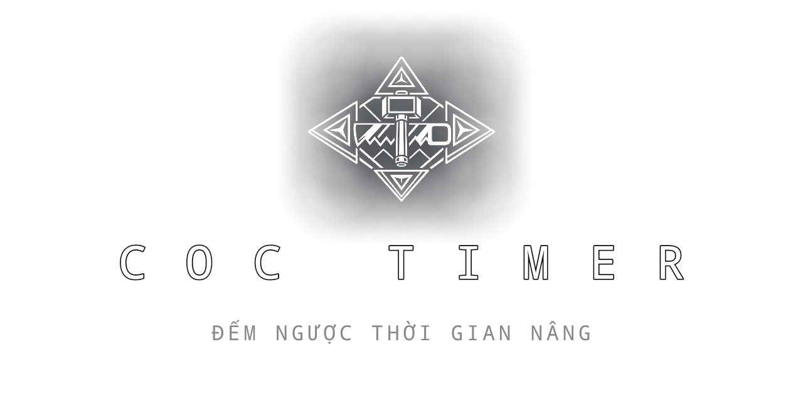
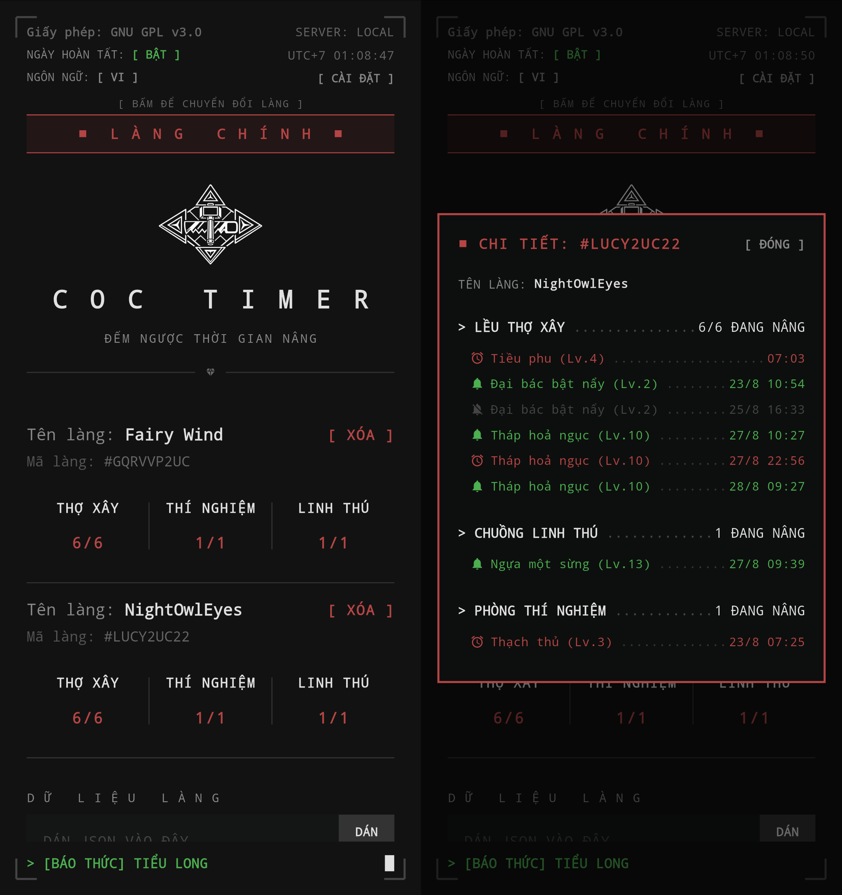
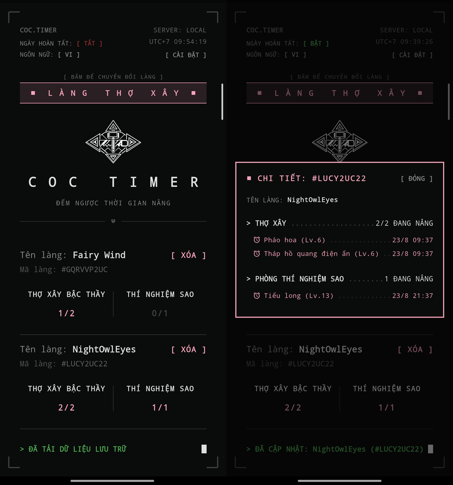
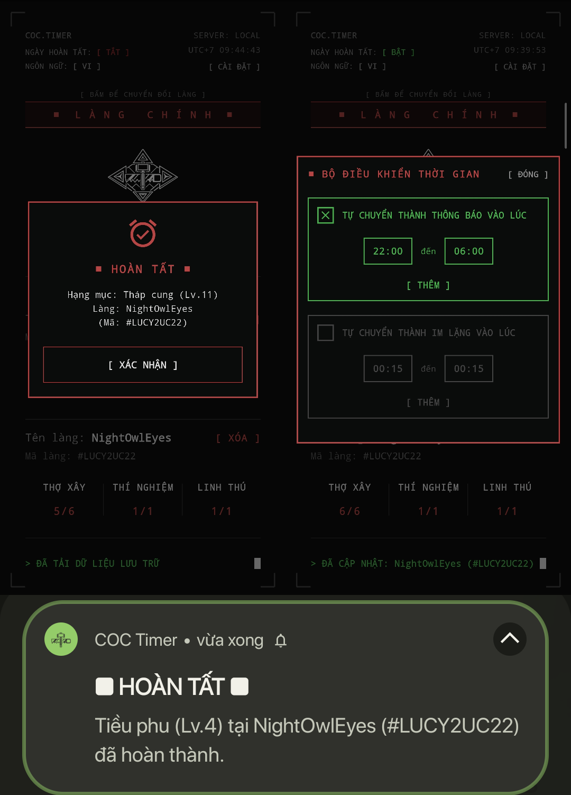
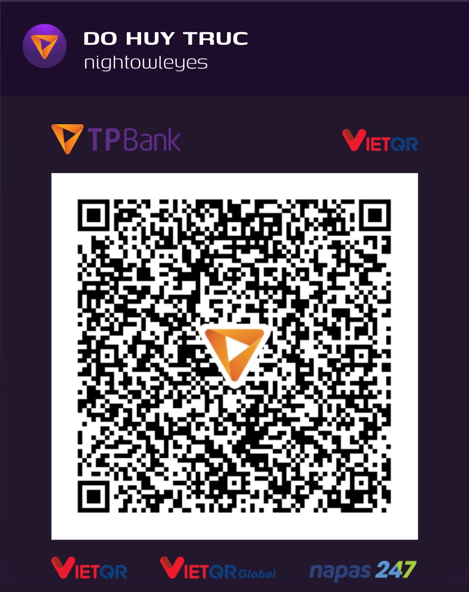

  <a href="README.md">English</a> | <a href="README-vi.md">Tiếng Việt</a>

  

## 📥 Tải xuống

| ABI | Phù hợp với | Tải xuống |
|------|-------------|-----------|
| **arm64-v8a** | ⭐ Đề xuất (phù hợp với hầu hết thiết bị Android từ khoảng 2018 đến nay). |  |
| **armeabi-v7a** | Thiết bị Android 32-bit dùng CPU ARM (khoảng trước 2017–2018). |  |
| **x86_64** | Thiết bị, giả lập Android 64-bit dùng CPU Intel/AMD x86 |  |

# COC Timer

Ứng dụng theo dõi thời gian nâng cấp công trình, thần chú, lính, linh thú... trong Clash of Clans, đồng thời tích hợp hệ thống kết nối API để theo dõi Clan War & CWL trực tuyến, kèm hệ thống nhắc nhở/báo thức thông minh.

## Tính năng nổi bật

### 1. Theo dõi tiến độ Làng (Offline)
- Hỗ trợ cả **Làng Chính** và **Căn cứ Thợ Xây** (Làng Đêm).
- Hỗ trợ **3 chế độ nhắc nhở** cho từng hạng mục nâng cấp:

| Chế độ | Mô tả |
|---|---|
| 🔕 Không thông báo | Không nhắc gì khi hoàn thành |
| 🔔 Nhắc nhở bằng thông báo | Gửi thông báo hệ thống khi hoàn thành |
| ⏰ Báo thức | Phát chuông báo toàn màn hình khi hoàn thành |

- **Tính toán Buff & Trợ lý thông minh:** Tự động tính thời gian hoàn thành thực tế (`realEta`) dựa trên Thuốc Thợ Xây, Thuốc Nghiên Cứu, Thuốc Linh Thú, Lương Khô, Súp Nghiên Cứu, Tháp Đồng Hồ, Thợ Xây Học Việc và Nghiên Cứu Học Việc.
- **Hỗ trợ Thợ xây Yêu tinh (Thợ thứ 7):** Đếm chính xác số thợ khi thuê thêm và tự động quay về 6/6 ngay khi thợ thứ 7 hoàn tất.
- **Cảnh báo thuốc:** Gắn dấu chấm than (`!`) cảnh báo các công trình hoàn tất trước khi thuốc tăng tốc hết tác dụng.

### 2. Tiện ích Dán Nhanh (Quick Paste)
- **Ghim thông báo dán nhanh:** Tạo một thông báo trên thanh trạng thái để người dùng chạm vào và lưu ngay dữ liệu JSON sau khi copy trong game mà không cần mở app thủ công.
- **Tự động quay lại game:** Tùy chọn tự động đóng app và trở về game ngay sau khi dán thành công.
- **Cơ chế Watchdog:** Tự động khôi phục thông báo trên các dòng Android cao nếu bị hệ thống hoặc người dùng vô tình gạt mất.

### 3. Theo dõi Clan War Trực Tuyến (Online)
- **Cổng kết nối API Live:** Quét dữ liệu War thường và Clan War League (CWL) trực tiếp từ máy chủ thông qua mã Clan (Tag).
- **Đồng bộ Ngầm:** Tự động làm mới dữ liệu War chạy ngầm định kỳ bằng Workmanager.
- **Truy xuất Chưa Tấn Công:** Nhanh chóng lọc danh sách các thành viên (phe ta và địch) chưa đánh hết số lượt quy định.
- **Bảng điều khiển CWL:** Theo dõi lịch thi đấu 7 ngày, ma trận ghép cặp và kết quả chi tiết của Clan War League.
- **Báo thức War:** Hẹn giờ báo thức trước khi War kết thúc hoặc báo ngay thời điểm War vừa khép lại (chọn giữa Thông báo hoặc Báo thức). Tự động tắt đồng bộ ngầm nếu chưa có Clan hoặc tắt cả 2 thông báo War.

## Cài đặt & Tùy biến

- **Bộ điều khiển thời gian (Lịch tự động):** Thiết lập các khung giờ nhập trực tiếp (`HH:MM`) để app tự động chuyển đổi chế độ nhắc nhở (VD: Tự động chuyển báo thức thành Im lặng hoặc Thông báo từ 22:00 đến 06:00).
- **Báo trước Nâng cấp:** Cài đặt thời gian đổ chuông/thông báo sớm *X* phút trước khi công trình hoàn tất (mặc định 2 phút).
- **Kiểu thời gian (Mốc giờ / Đếm ngược):** Chuyển đổi linh hoạt giữa hiển thị Mốc giờ hoàn thành (`14:30`) hoặc Thời gian đếm ngược (`2h 15m`) cho cả công trình và thời gian hiệu lực của các loại thuốc/học việc.
- **Tự động cập nhật:** Quét GitHub lúc khởi động và thông báo khi có phiên bản mới.

## Cách sử dụng

### Dùng để theo dõi nâng cấp Làng (Chế độ Offline)
1. Vào **Cài đặt game** > **Thêm cài đặt** > **Xuất dữ liệu làng theo định dạng JSON**.
2. Mở app COC Timer và cấp quyền thông báo / báo thức.
3. Cuộn xuống, bấm nút **DÁN** để nhập dữ liệu JSON vừa xuất (hoặc bật **DÁN NHANH** để dán trực tiếp từ thanh thông báo).
4. Nhấn vào **tên từng công trình** để chuyển đổi qua lại giữa 3 chế độ nhắc nhở.
5. Nhấn vào **tên tiêu đề nhóm** (Thợ xây, Linh thú, Phòng thí nghiệm) để chuyển đổi chế độ **hàng loạt** cho cả nhóm.
6. Chạm vào thẻ làng để mở hộp thoại Chi tiết, đổi tên làng, cấu hình theo dõi hoặc chuyển đổi **Kiểu thời gian** (`[ MỐC GIỜ ]` / `[ ĐẾM NGƯỢC ]`).

### Dùng để theo dõi Clan War (Chế độ Online)
1. Bấm vào nút chuyển đổi server ở góc trên màn hình để sang chế độ **C L A N   W A R (API)**.
2. Dán hoặc nhập **Mã Clan (Tag)** vào ô trống và xác nhận.
3. Bấm vào Clan đã lưu để mở Bảng điều khiển War, xem tỉ số trực tiếp, danh sách chưa tấn công và lịch trình CWL.

## Ảnh chụp màn hình

  

  

  

  

---

## Ủng hộ dự án (Support the project)

Nếu bạn thấy COC Timer hữu ích, hãy cân nhắc ủng hộ để duy trì và phát triển dự án!

### Quyên góp qua mã QR

