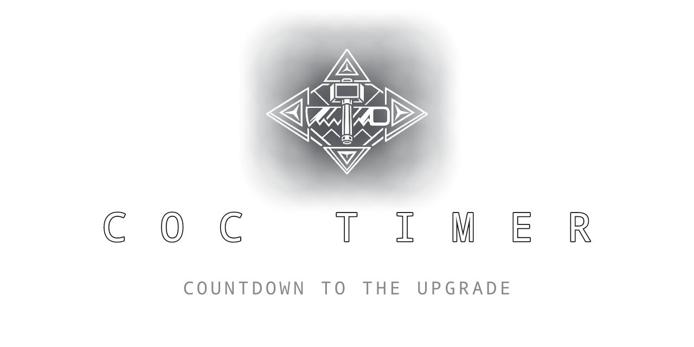
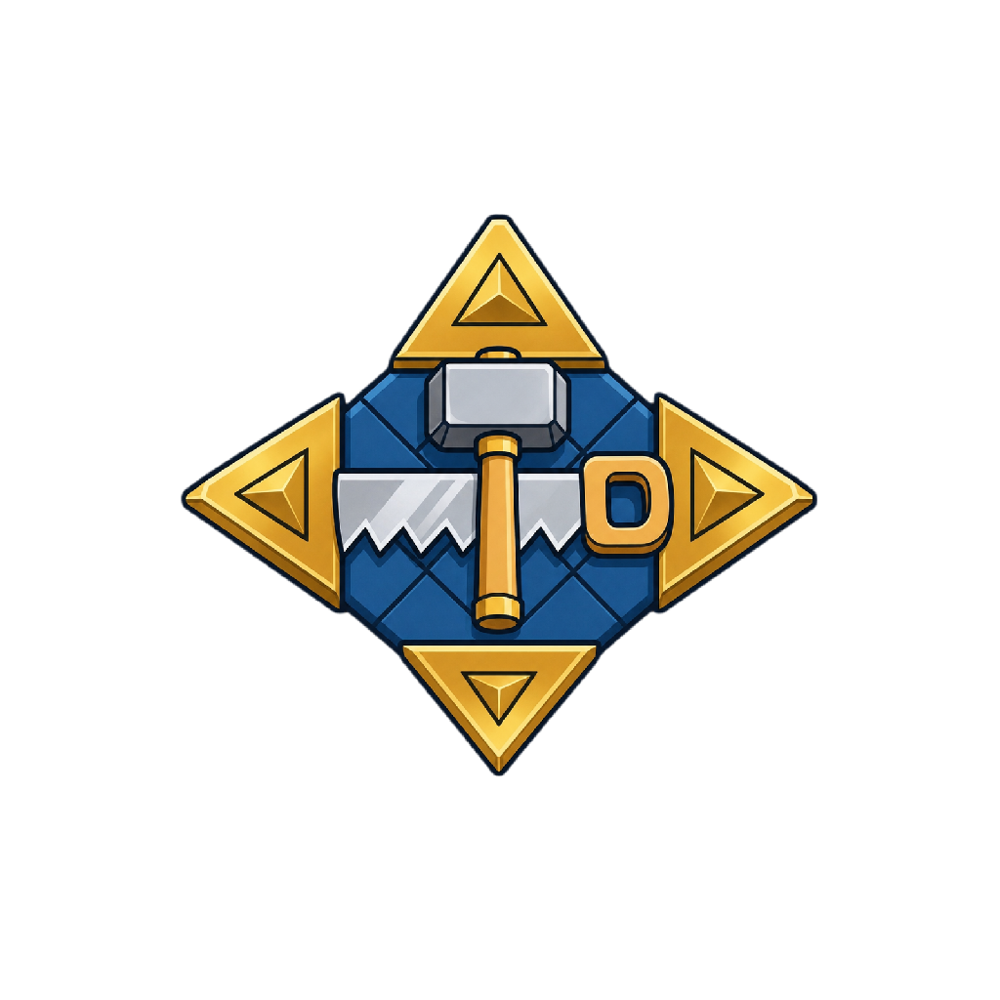
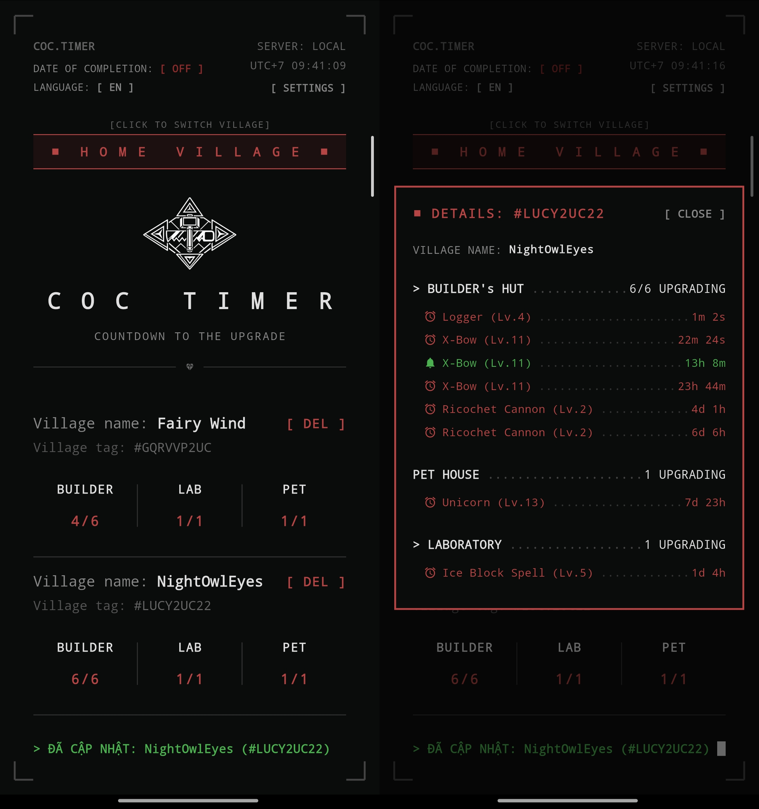
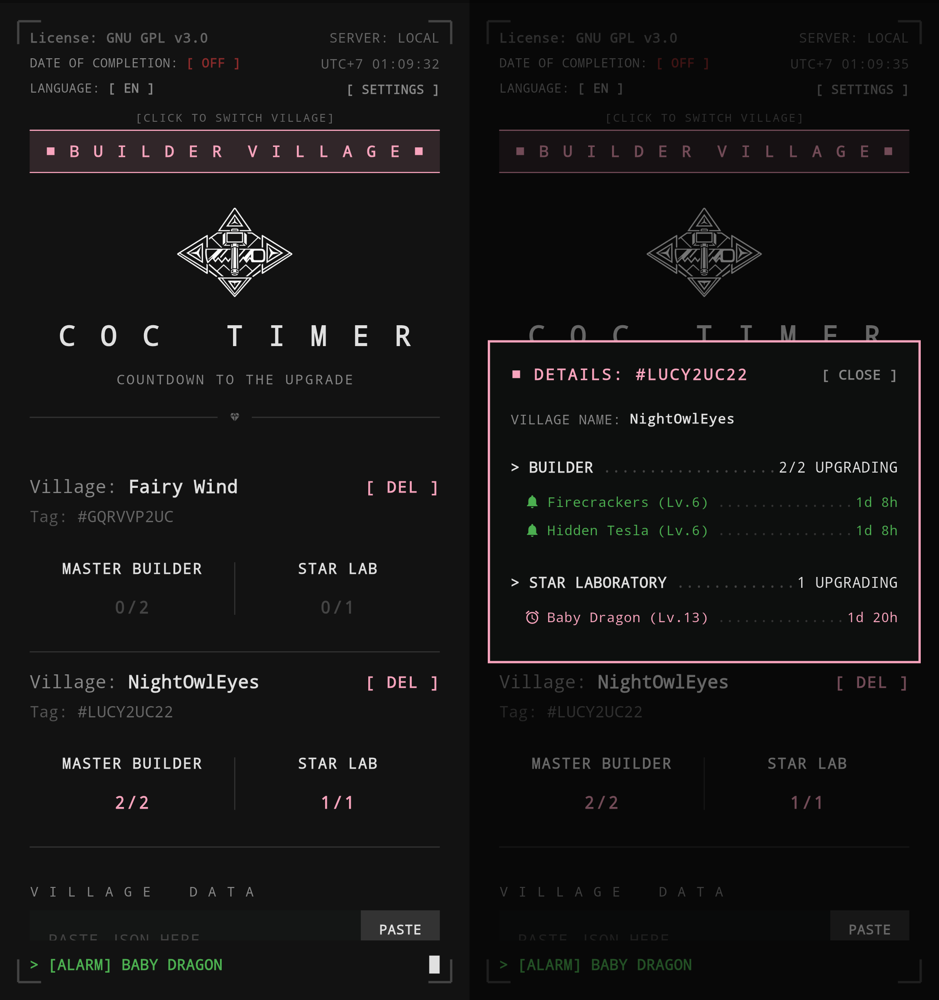
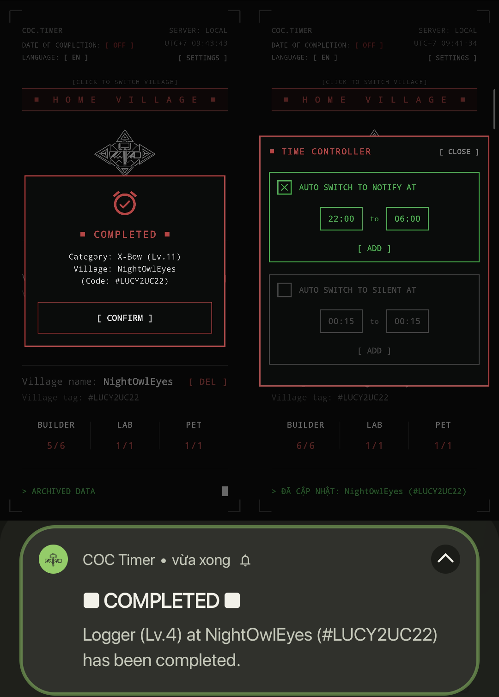

  <a href="README.md">English</a> | <a href="README-vi.md">Tiếng Việt</a>

  

## 📥 Download

| ABI | Compatible with | Download |
|------|-------------|-----------|
| **arm64-v8a** | ⭐ Recommended (compatible with most Android devices from around 2018 to present) |  |
| **armeabi-v7a** | 32-bit Android devices using ARM CPUs (approximately before 2017–2018) |  |
| **x86_64** | The device uses a 64-bit Android emulator with an Intel/AMD x86 CPU. |  |

# COC Timer

An app for tracking upgrade timers for buildings, spells, troops, pets, and more in Clash of Clans, with a built-in reminder/alarm system for when they finish.

## Features

### 1. Offline Village Tracking
The app supports **3 reminder modes** for each upgrade item:

| Mode | Description |
|---|---|
| 🔕 No notification | No reminder when the upgrade finishes |
| 🔔 Notification reminder | Send a notification when completed |
| ⏰ Alarm | Sound an alarm when finished |

### 2. Online Clan War Tracking
- **Live API Gateway:** Track Regular Clan Wars and Clan War Leagues (CWL) using Clan Tags.
- **Background Sync:** Automatically fetches war data in the background (configurable).
- **Missed Attacks Tracker:** Quickly check which members (ally or enemy) haven't completed their attacks.
- **CWL Dashboard:** View the 7-day schedule, matchmaking matrix, and results for Clan War Leagues.
- **War Alarms:** Setup pre-alarms before the war ends, or trigger an alarm exactly when it concludes.

## Settings

- **Time Controller (Schedule):** Set specific timeframes for the app to automatically switch reminder modes. Example: Automatically switch all alarms to Silent (or Notify) from 22:00 to 06:00 so your sleep isn't disturbed.
- **Pre-alarm (Village):** Set the alarm/notification to trigger *X* minutes before the upgrade actually finishes, giving you time to log in to the game.
- **War Alarm Config:** Configure separate alarms for Clan Wars (Pre-alarm before end, and End alarm) with options to choose between standard notifications or full-screen alarms.
- **Auto Check Update:** The app automatically checks GitHub on launch and alerts you to download if a new version is available.

## How to use

### Tracking Village Upgrades (Offline)
1. In the game, go to **Settings** > **More Settings** > **Export village data as JSON**
2. Open the COC Timer app
3. Scroll down and tap **Paste** to import the JSON data you just exported
4. Tap the **name of any item** to cycle through the 3 reminder modes
5. Tap the **group title** (e.g. Builders, Pets, Laboratory) to change the mode for the **whole group** at once

### Tracking Clan Wars (Online)
1. Tap on the server toggle button at the top to switch to **ONLINE SERVER (API)** mode.
2. Paste or enter a **Clan Tag** and confirm.
3. Tap on the saved clan to open the War Dashboard and view live stats, missed attacks, and CWL schedules.

### Date of completion
The app has a toggle for how time is displayed:
- **Off**: shows a countdown (e.g. `2h 15m`)
- **On**: shows the actual completion time (e.g. `14:30`)

## Screenshots

  

  

  

  

---

## Support the project

If you find COC_Timer useful, consider supporting its development!

### Donate via QR Code

