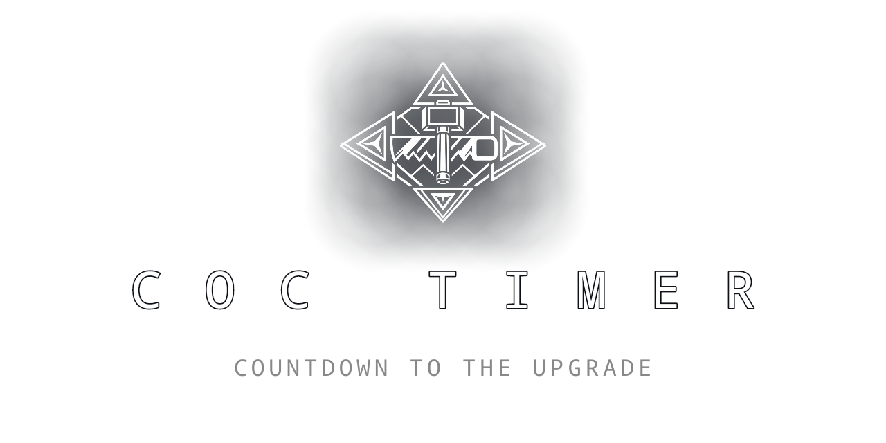
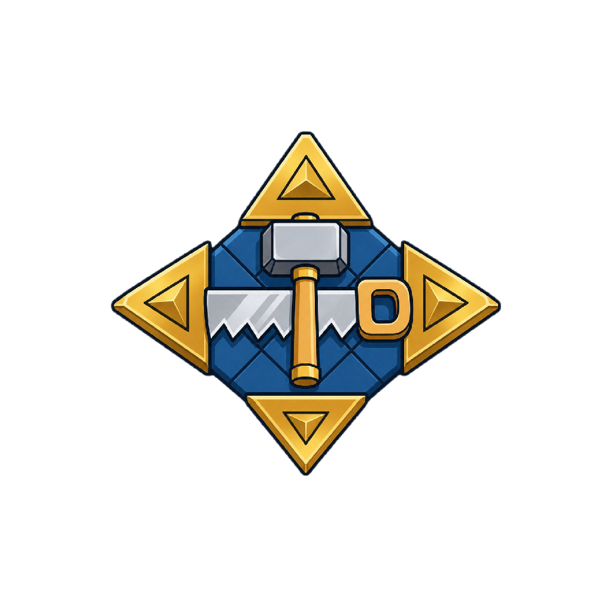
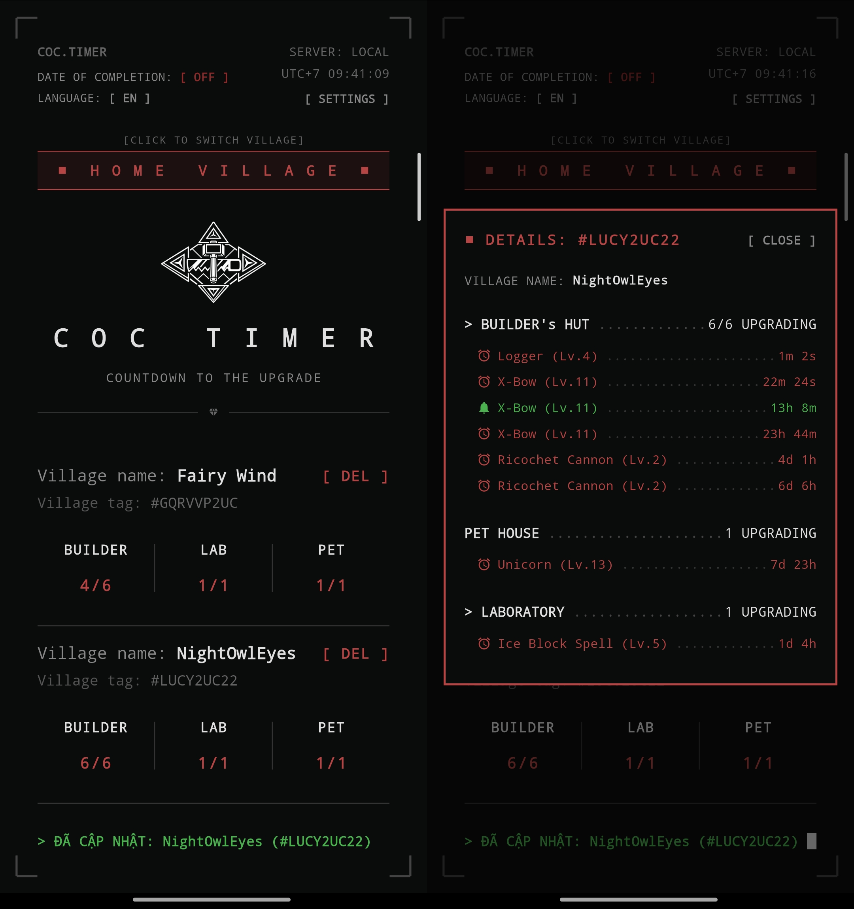
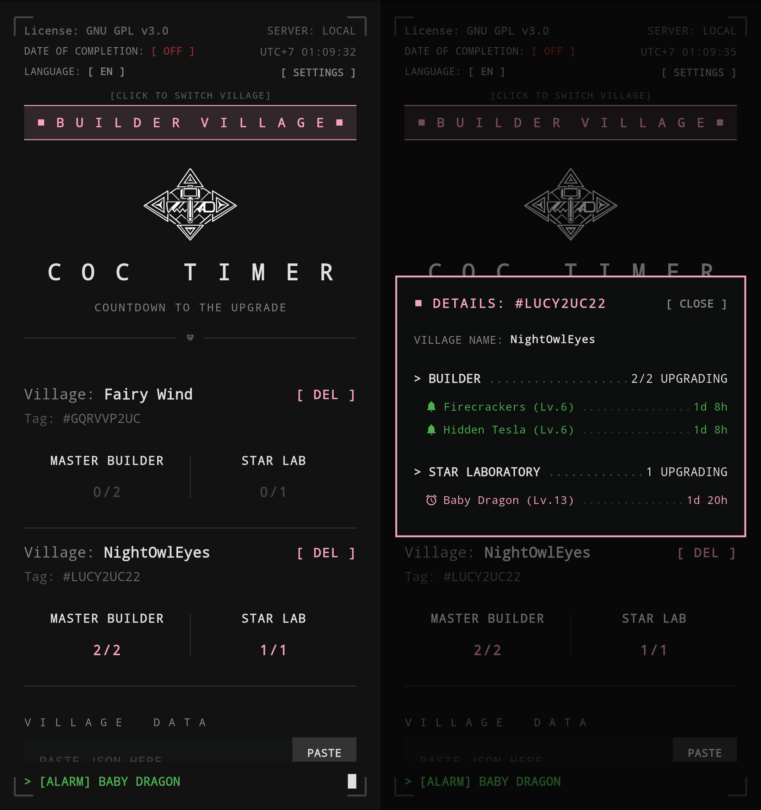
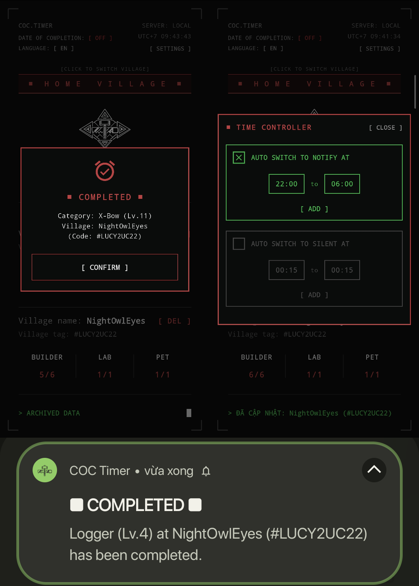

  <a href="README.md">English</a> | <a href="README-vi.md">Tiếng Việt</a>

  

## 📥 Download

| ABI | Compatible with | Download |
|------|-------------|-----------|
| **arm64-v8a** | ⭐ Recommended (compatible with most Android devices from around 2018 to present) |  |
| **armeabi-v7a** | 32-bit Android devices using ARM CPUs (approximately before 2017–2018) |  |
| **x86_64** | Devices or 64-bit Android emulators with Intel/AMD x86 CPUs |  |

# COC Timer

An application for tracking upgrade timers for buildings, spells, troops, pets, and apprentices in Clash of Clans, featuring an API gateway for live Clan War & CWL monitoring, along with an intelligent reminder and alarm system.

## Key Features

### 1. Village Progress Tracking (Offline)
- Supports both **Home Village** and **Builder Base**.
- Offers **3 reminder modes** for each upgrade:

| Mode | Description |
|---|---|
| 🔕 No notification | Silent upon completion |
| 🔔 Notification reminder | Sends a system notification when completed |
| ⏰ Full-screen alarm | Sounds a full-screen ringing alarm when completed |

- **Advanced Boost & Apprentice Calculation:** Automatically calculates the exact real-time finish time (`realEta`) accounting for Builder Potions, Research Potions, Pet Potions, Builder Bites, Study Soup, Clock Tower, Builder's Apprentice, and Lab Assistant.
- **Goblin Builder (7th Builder) Support:** Accurately counts builders when the extra builder is hired and automatically resets back to 6/6 when completed.
- **Boost Expiration Warning:** Highlights upgrades with an exclamation mark (`!`) if they finish before the active boost expires.

### 2. Quick Paste Mode
- **Status Bar Notification:** Pin a handy notification to your status bar to paste JSON data right after copying in-game without manually opening the app.
- **Auto-Return to Game:** Optional toggle to automatically return to the game immediately after pasting.
- **Watchdog Auto-Recovery:** Automatically restores the Quick Paste notification on newer Android versions if dismissed by the system or user.

### 3. Live Clan War Monitoring (Online)
- **Live API Gateway:** Fetches Regular War and Clan War League (CWL) data directly using Clan Tags.
- **Background Sync:** Periodically refreshes war data in the background using Workmanager.
- **Missed Attacks Filter:** Quick overview of members (friendly and enemy) who have not used their war attacks.
- **CWL Dashboard:** Visualizes the 7-day schedule, clan matchmaking matrix, and round-by-round results.
- **War Alarms:** Setup pre-alarms before the war ends, or trigger an alarm exactly when it concludes. Automatically pauses background sync if no clans are saved or if both alerts are disabled.

## Settings & Customization

- **Time Controller (Schedule Rules):** Define direct timeframes (`HH:MM`) to automatically switch reminder modes (e.g., automatically switch alarms to Silent or Notification between 22:00 and 06:00).
- **Pre-alarm Reminder:** Trigger alerts *X* minutes before the upgrade actually finishes (default: 2 minutes).
- **Time Format Toggle:** Effortlessly switch between Exact Finish Time (`14:30`) and Countdown (`2h 15m`) inside the Village Details dialog for both upgrades and boost durations.
- **Auto Update Check:** Automatically checks GitHub upon launch and alerts you when a new release is available.

## How to Use

### Tracking Village Upgrades (Offline)
1. In Clash of Clans, navigate to **Settings** > **More Settings** > **Export village data as JSON**.
2. Open COC Timer and grant notification/alarm permissions.
3. Scroll down and tap **PASTE** to import your JSON data (or turn on **QUICK PASTE** to paste directly from your notification bar).
4. Tap the **name of any item** to toggle between the 3 reminder modes.
5. Tap the **group title** (Builders, Pets, Laboratory) to batch-toggle the mode for the entire group.
6. Tap on a village card to view details, rename, change tracking preferences, or toggle the **Time Format** (`[ EXACT TIME ]` / `[ COUNTDOWN ]`).

### Tracking Clan Wars (Online)
1. Tap the server toggle at the top of the screen to switch to **C L A N   W A R (API)** mode.
2. Paste or enter a **Clan Tag** and confirm.
3. Tap on the saved clan to open the War Dashboard, view live stats, missed attacks, and CWL schedules.

## Screenshots

  

  

  

  

---

## Support the project

If you find COC Timer useful, consider supporting its development!

### Donate via QR Code

